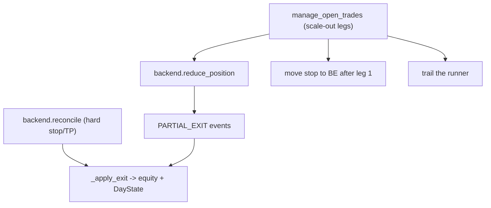

# Scaled-exit engine (+ R:R guard)

## Why (from the 12-month verdict)

Entry has no edge across pullback/breakout/WFX/confluence; confluence is a genuine risk/quality filter but not alpha. The lever is the **exit**: 41-46% win rate at these R:R levels is the killer. Goal: a smarter exit - **partial at Kijun -> runner to Span A -> trail beyond** - to bank profit earlier and turn expectancy less-negative/positive without touching the entry. R:R guard is kept as a cheap safety net and to verify parity with OANDA.

## Current architecture (single-TP only)

- `SimulatedBackend._Open` holds one signed unit block with a single `tp`/`stop`; `reconcile` settles a full exit and deletes the position ([simulated.py](trading-agent/trading_agent/execution/simulated.py)). `oanda_paper.request_close` closes `units: ALL` ([oanda_paper.py](trading-agent/trading_agent/execution/oanda_paper.py)).
- `manage_open_trades` runs each bar AFTER `reconcile` and BEFORE the gates ([engine.py](trading-agent/trading_agent/engine.py)); it already reads the snapshot's entry-tf Kijun for trailing ([trade_management.py](trading-agent/trading_agent/trade_management.py)).
- The engine's reconcile loop is the single place exit P/L folds into `equity` + `DayState` (daily-loss halt). `EventLog.replay_today` rebuilds day P/L from `EXIT` records.

## Part 1 - Scaled-exit engine

Drive partials from `manage_open_trades` (it has the snapshot with Kijun/Span A) and let the backend execute the partial close. Route the resulting P/L through the same equity/day-state accounting as normal exits.

### Config ([config.py](trading-agent/trading_agent/config.py), [config/risk.yaml](trading-agent/config/risk.yaml))

Extend `ManagementConfig` with a frozen `ScaleOutConfig` (no-op default => today's single-TP behavior):

```yaml
management:
  breakeven_enabled: true
  breakeven_trigger_pips: 10.0     # NEW: arm BE only once price is >=10 pips in profit (pip-based)
  breakeven_buffer_pips: 0.0       # then move stop to TRUE entry (risk-free at 0), was +1 pip
  breakeven_trigger_r: 1.5         # fallback trigger (R multiple) used only when breakeven_trigger_pips == 0
  trail_mode: kijun
  trail_distance_pips: 25          # loosened from 10 for breathing room
  scale_out:                       # NEW (omit/enabled:false => single-TP as today)
    enabled: true
    legs:                          # ordered; each banks `fraction` of ORIGINAL units at `level`
      - {level: kijun,  fraction: 0.5}
      - {level: span_a, fraction: 0.25}
    move_be_after_first: true      # after leg 1 fills, move stop to breakeven+buffer
    runner_trail: kijun            # off|kijun|pips for the final remainder (reuses trail_distance_pips)
```

`level` is drawn from the entry-tf Ichimoku frame (`kijun`, `span_a`, `span_b`, `tenkan`); the runner's ultimate target stays the strategy's `tp`.

### Breakeven engagement (arm late, stop to true entry)

Desired behavior: **arm breakeven only once price is >=10 pips in profit, then move the stop to true entry (0 profit / risk-free)** - not the current "arm at 1R, park stop at +1 pip." Fix in `compute_managed_stop` ([trade_management.py](trading-agent/trading_agent/trade_management.py)):
- Add a **pip-based arm trigger** `breakeven_trigger_pips`: BE arms when the bar's favorable extreme reaches `entry +/- breakeven_trigger_pips * pip` (LONG uses `bar.h`, SHORT uses `bar.l`). When `breakeven_trigger_pips == 0`, fall back to the existing R-multiple trigger (`breakeven_trigger_r * R`) so old configs are unchanged.
- On arming, place the stop at `entry +/- breakeven_buffer_pips * pip` with `breakeven_buffer_pips: 0` => **true entry**. (Buffer stays configurable if the user later wants a small cost cushion.)
- The existing only-improve guard still prevents loosening; with a 10-pip arm and 0 buffer the stop is always strictly behind market, so no through-market case.
- Applies identically to the scale-out "move to BE after leg 1" step. Note: after leg 1 the trade is already risk-free at the strategy level (profit banked); moving the remainder's stop to true entry is consistent.

### Types ([types.py](trading-agent/trading_agent/types.py))

- `OpenTrade`: add `remaining_units` (current live size; `units` stays the original for R math).
- `TradeEvent`: add `partial: bool = False` and `remaining_units: int | None = None` (back-compatible defaults).

### Backend partial close ([base.py](trading-agent/trading_agent/execution/base.py), simulated, oanda_paper)

- Protocol: `reduce_position(trade_id, units_to_close, price) -> TradeEvent | None` - close a magnitude of units now, keep the remainder open, return the partial `EXIT` event.
  - Simulated: reduce `_Open.units` by the signed amount; emit `TradeEvent(kind="EXIT", partial=True, remaining_units=..., pnl=closed*(price-entry))`; delete only when remainder hits 0.
  - OANDA: `trades.TradeClose(units=str(abs(units_to_close)))`; extend `_events_from_transactions` to parse `tradeReduced` (partial) as a partial `EXIT` and update the local mirror's units instead of popping (full closes still come via `tradesClosed`).

### Management drives scale-out ([trade_management.py](trading-agent/trading_agent/trade_management.py))

`manage_open_trades` returns `list[TradeEvent]` (partials). Per open position, when `scale_out.enabled`: compute the next unfilled leg's level price from the snapshot; if the bar's favorable extreme reached it, `reduce_position(round(fraction*orig_units), level_price)`; after leg 1, move stop to BE+buffer; trail the remainder via `runner_trail`. Leg sizes below `pair.min_units` are folded into the next leg / final close. Intrabar order: `reconcile` (hard stop/TP) settles first, so partials only fire on non-stop bars - documented pessimism, consistent with the existing STOP-before-TP tie-break.

### Direction symmetry (buy AND sell)

All exit logic is fully symmetric by `sign(units)`, mirroring the existing `compute_managed_stop` / `_exit_price`:
- **LONG**: leg/target levels sit ABOVE entry; "reached" tested against `bar.h`; partial closes sell units (reduce a positive position); BE/trail only ratchet the stop UP.
- **SHORT**: leg/target levels sit BELOW entry; "reached" tested against `bar.l`; partial closes buy back units (reduce a negative position); BE/trail only ratchet the stop DOWN.
A leg only counts if its level is genuinely in-profit for that direction (LONG: `level > entry`; SHORT: `level < entry`); otherwise it is skipped, so a mis-ordered Ichimoku level never banks at a loss. The `reduce_position` `units_to_close` is a magnitude; the backend reduces toward zero regardless of side. Tests cover both a LONG and a SHORT scale-out path.

### Engine accounting ([engine.py](trading-agent/trading_agent/engine.py))

Extract `_apply_exit(ev, equity, day, cfg, log, now)` (equity += pnl, `update_day_state`, HALT on breach) and call it from BOTH the reconcile loop and a new loop over `manage_open_trades(...)` return value. Log partials as `PARTIAL_EXIT` (full closes stay `EXIT`). Add `PARTIAL_EXIT` P/L to `EventLog.replay_today` so restarts keep the daily-loss halt correct.



## Part 2 - Centralized R:R invariant + visibility

- [risk.py](trading-agent/trading_agent/risk.py) `RiskEngine.evaluate` (single choke point): after `stop_distance`, add directional side checks (LONG: `stop < entry_ref < tp`; SHORT: `tp < entry_ref < stop` -> `tp_wrong_side`/`stop_wrong_side`) and an R:R floor (`abs(tp-entry_ref) >= min_rr*abs(entry_ref-stop)` else `rr_below_floor`).
- Add `min_rr` (default `1.0`, non-breaking) to `RiskConfig` in [config.py](trading-agent/trading_agent/config.py) + [config/risk.yaml](trading-agent/config/risk.yaml).
- Floor the real inversion path in [ichimoku_confluence.py](trading-agent/trading_agent/strategy/ichimoku_confluence.py): accept the `ichimoku_level` TP only if reward >= `min_rr*risk`, else keep the inner `rr` TP.
- Visibility: log computed `rr` on `SUBMIT` ([engine.py](trading-agent/trading_agent/engine.py)); add an **R:R column** to the Positions table in [reduceEvents.ts](src/app/utils/reduceEvents.ts) + [TradingDashboard.tsx](src/app/components/TradingDashboard.tsx) to check against the OANDA ticket.

## Part 3 - UI: partial exits + R:R ([reduceEvents.ts](src/app/utils/reduceEvents.ts), [TradingDashboard.tsx](src/app/components/TradingDashboard.tsx))

Handle `PARTIAL_EXIT`: accumulate banked P/L on the trade, keep `status: "open"` until `remaining_units == 0` (then the final `EXIT` closes it), and show a "scaled" badge + remaining size. Add the R:R column. Update the `reduceEvents` self-check fixture with a partial sequence.

## Part 4 - Validate (before/after, not a full grid)

Run the deterministic 12-month backtest twice - `scale_out.enabled: false` vs `true` - and compare expectancy, win rate, max drawdown, and P/L to confirm the smarter exit helps. Reuse [engine.py](trading-agent/trading_agent/engine.py) + the reduce metrics; a lightweight two-config comparison, not the parameter grid (deferred as a follow-up once the mechanism is proven).

## Tests

- [tests/test_trade_management.py](trading-agent/tests/test_trade_management.py): leg-1 banks at Kijun + stop moves to BE; leg-2 at Span A; runner trails; determinism - covered for BOTH a LONG (levels above, `bar.h`) and a SHORT (levels below, `bar.l`).
- [tests/test_execution_sim.py](trading-agent/tests/test_execution_sim.py): `reduce_position` partial P/L + remaining, full close on final leg.
- [tests/test_oanda_paper_parse.py](trading-agent/tests/test_oanda_paper_parse.py): `tradeReduced` -> partial `EXIT`, mirror units updated.
- [tests/test_risk.py](trading-agent/tests/test_risk.py): `tp_wrong_side`, `stop_wrong_side`, `rr_below_floor`; confluence TP-floor case.
- `reduceEvents` self-check: partial-then-final sequence sums banked P/L and closes once.

## Notes / call-outs

- Public-interface change: `ExecutionBackend` gains `reduce_position` and `manage_open_trades` now returns events - both internal seams (Protocol + engine), no external SDK surface, but flagged per repo policy.
- Config drift (separate from this work): `stop_rule: atr` in [strategy_v1.yaml](trading-agent/config/strategy_v1.yaml) is ignored by the active pullback strategy (uses the Kijun stop). Say the word to switch to the ATR (volatility) stop for wider breathing room.
- `make test` / `uv run pytest`; `uvx ruff check .`; `npx tsx src/app/utils/reduceEvents.ts` for the UI reducer self-check.
